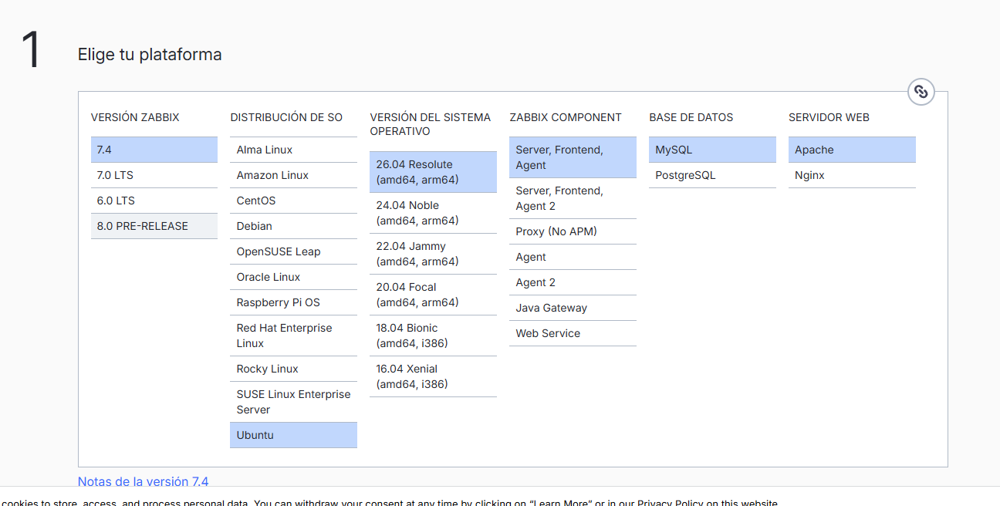
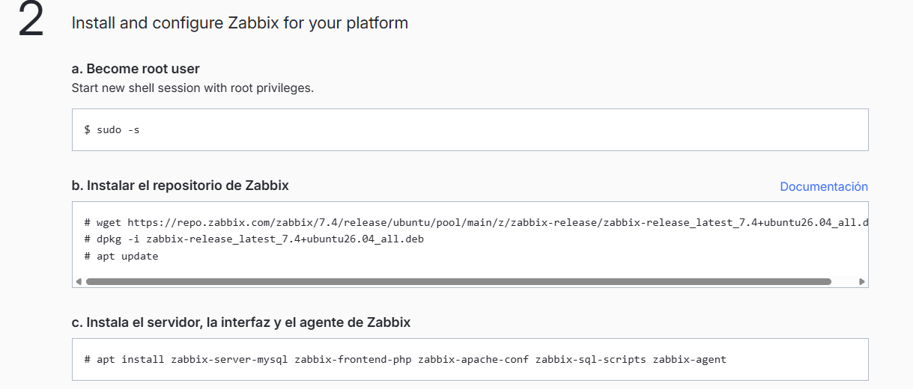
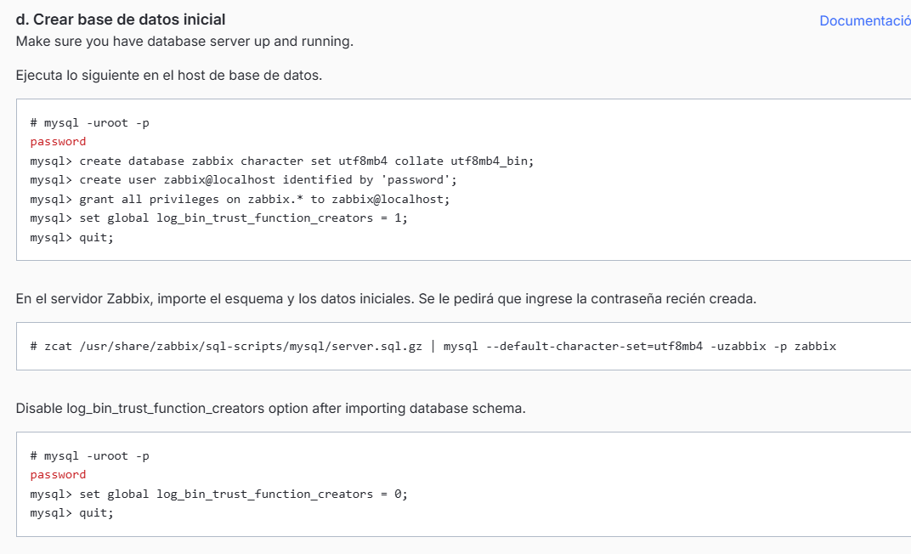
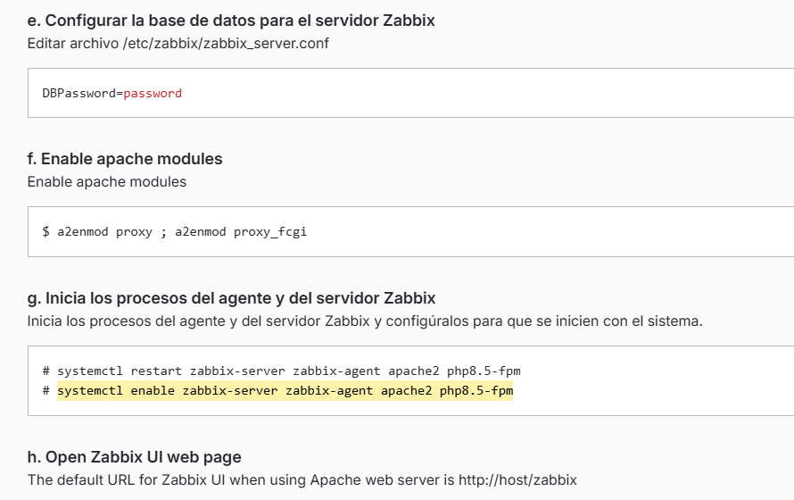
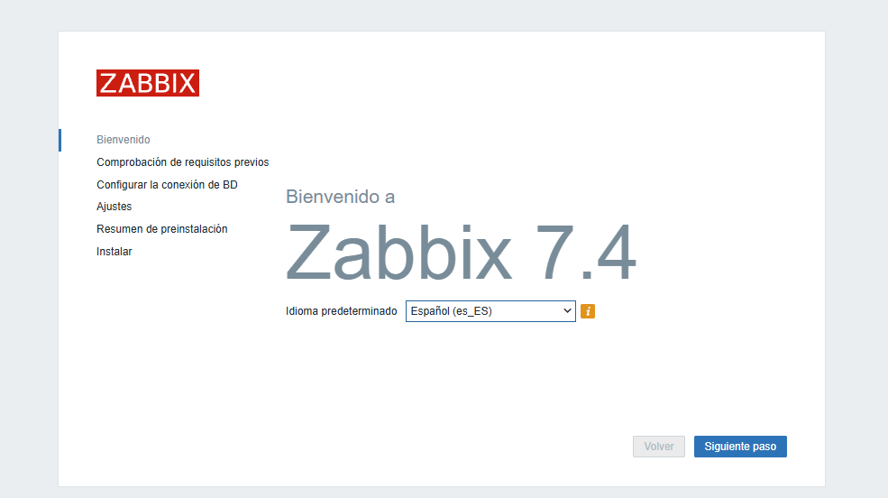
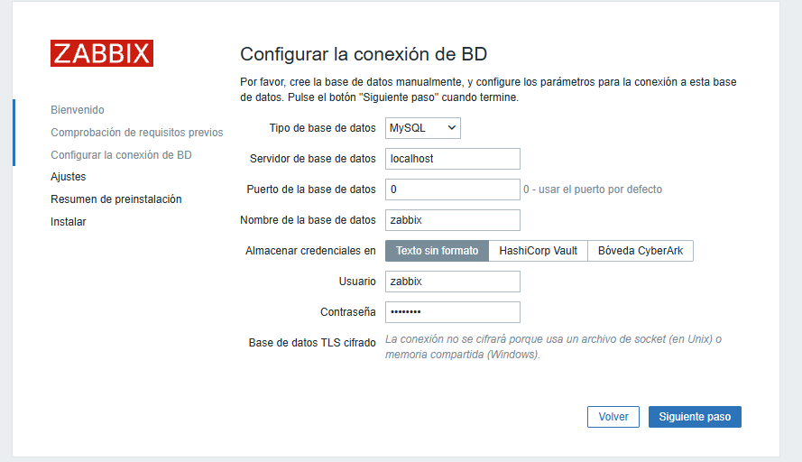
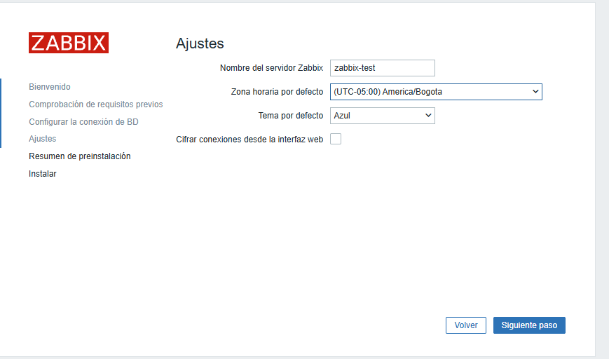
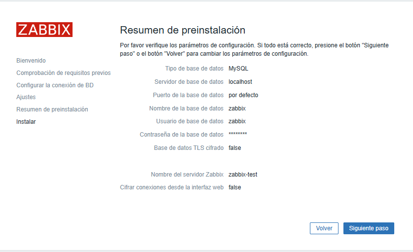
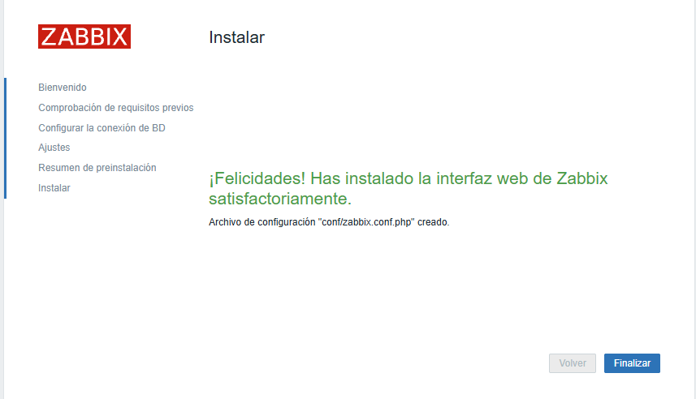
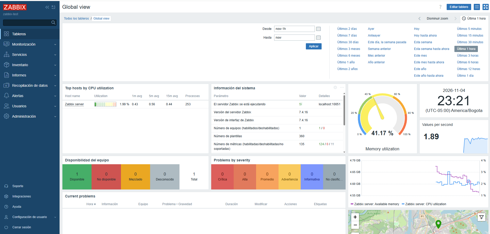

---
tags:
  - zabbix
  - monitoreo
  - soc
  - ubuntu
  - virtualbox
  - mariadb
  - laboratorio
herramienta: Zabbix 7.4
sistema_operativo: Ubuntu 26.04
base_de_datos: MariaDB
servidor_web: Apache
plataforma_virtualizacion: VirtualBox
fecha_laboratorio: 2026-11-04
estado: Completado ✅
---

# Instalar Zabbix 7.4 en Ubuntu 26.04 desde Cero (VirtualBox + MariaDB)

Laboratorio de despliegue de **Zabbix 7.4** (plataforma de monitoreo) sobre Ubuntu 26.04, usando MariaDB como base de datos y Apache como servidor web.

Referencia usada para generar los comandos: [Zabbix Download & Install Wizard](https://www.zabbix.com/la/download?zabbix=7.4&os_distribution=ubuntu&os_version=26.04&components=server_frontend_agent&db=mysql&ws=apache)

## 📋 Resumen

| Campo | Detalle |
|---|---|
| Herramienta | Zabbix 7.4 (versión final del agente/server confirmada: 7.4.16) |
| SO | Ubuntu 26.04 Resolute |
| Base de datos | MariaDB (`zabbix-server-mysql`) |
| Servidor web | Apache |
| Componentes instalados | Server, Frontend, Agent |
| Usuario de BD | `zabbix` |
| Contraseña de BD | `Sistemas123` |
| Nombre del servidor Zabbix | `zabbix-test` |
| Zona horaria | America/Bogota (UTC-05:00) |
| Acceso web | `http://<host>/zabbix` — Usuario `Admin` / Contraseña `zabbix` (por defecto) |

---

## 1️⃣ Elegir plataforma (Wizard de descarga de Zabbix)

Selección en el asistente oficial de Zabbix:
- **Versión Zabbix:** 7.4
- **Distribución:** Ubuntu
- **Versión del SO:** 26.04 Resolute
- **Componente:** Server, Frontend, Agent
- **Base de datos:** MySQL (MariaDB)
- **Servidor web:** Apache



---

## 2️⃣ Instalar y configurar Zabbix

### a. Convertirse en usuario root
```bash
sudo -s
```

### b. Instalar el repositorio de Zabbix
```bash
wget https://repo.zabbix.com/zabbix/7.4/release/ubuntu/pool/main/z/zabbix-release/zabbix-release_latest_7.4+ubuntu26.04_all.deb
dpkg -i zabbix-release_latest_7.4+ubuntu26.04_all.deb
apt update
```

### c. Instalar el servidor, la interfaz y el agente de Zabbix
```bash
apt install zabbix-server-mysql zabbix-frontend-php zabbix-apache-conf zabbix-sql-scripts zabbix-agent
```



Durante la instalación de MariaDB se definió la contraseña de root/administración:
```
apt install mariadb-server -y
```
Contraseña usada: `Sistemas123`

---

## 3️⃣ Crear la base de datos inicial

Ejecutado en el host de base de datos:
```sql
mysql -uroot -p
-- (contraseña)
create database zabbix character set utf8mb4 collate utf8mb4_bin;
create user zabbix@localhost identified by 'Sistemas123';
grant all privileges on zabbix.* to zabbix@localhost;
set global log_bin_trust_function_creators = 1;
quit;
```

Importar el esquema y los datos iniciales en el servidor Zabbix (pide la contraseña recién creada):
```bash
zcat /usr/share/zabbix/sql-scripts/mysql/server.sql.gz | mysql --default-character-set=utf8mb4 -uzabbix -p zabbix
```

Desactivar `log_bin_trust_function_creators` después de importar el esquema:
```sql
mysql -uroot -p
set global log_bin_trust_function_creators = 0;
quit;
```



---

## 4️⃣ Configurar la base de datos, Apache y los servicios

**e. Configurar la base de datos para el servidor Zabbix** — editar `/etc/zabbix/zabbix_server.conf`:
```
DBPassword=Sistemas123
```

**f. Habilitar módulos de Apache:**
```bash
a2enmod proxy ; a2enmod proxy_fcgi
```

**g. Iniciar y habilitar los servicios de Zabbix:**
```bash
systemctl restart zabbix-server zabbix-agent apache2 php8.5-fpm
systemctl enable zabbix-server zabbix-agent apache2 php8.5-fpm
systemctl enable mariadb
```

Verificar el estado del servicio:
```bash
systemctl status zabbix-server.service
```

**h.** URL por defecto de la interfaz web con Apache: `http://<host>/zabbix`



---

## 5️⃣ Asistente de instalación web (Frontend)

**Pantalla de bienvenida** — idioma: Español (es_ES):



**Configurar la conexión de BD:**

| Campo | Valor |
|---|---|
| Tipo de base de datos | MySQL |
| Servidor de base de datos | localhost |
| Puerto | 0 (por defecto) |
| Nombre de la base de datos | zabbix |
| Usuario | zabbix |
| Contraseña | Sistemas123 |



**Ajustes generales:**

| Campo | Valor |
|---|---|
| Nombre del servidor Zabbix | zabbix-test |
| Zona horaria | (UTC-05:00) America/Bogota |
| Tema | Azul |
| Cifrar conexiones desde la interfaz web | No |



**Resumen de preinstalación** — verificación final antes de instalar:



**Instalación completada:**

> ¡Felicidades! Has instalado la interfaz web de Zabbix satisfactoriamente.
> Archivo de configuración "conf/zabbix.conf.php" creado.



---

## 6️⃣ Primer acceso y dashboard

Login con las credenciales por defecto:
- Usuario: `Admin`
- Contraseña: `zabbix`

**Dashboard "Global view"** funcionando — servidor Zabbix activo, versión **7.4.16**, 1 host disponible, sin problemas activos:



---

## 🧠 Lecciones aprendidas

- El asistente oficial de descarga de Zabbix (`zabbix.com/download`) genera los comandos exactos según la combinación SO + versión + componentes + base de datos + servidor web elegidos — conviene partir siempre de ahí para evitar errores de paquetes.
- `log_bin_trust_function_creators` debe activarse **solo durante la importación** del esquema SQL y desactivarse después; es un ajuste de seguridad de MySQL/MariaDB, no una configuración permanente de Zabbix.
- Tras instalar, **cambiar la contraseña por defecto** del usuario `Admin` (actualmente `zabbix`) es el primer paso de hardening antes de usar la plataforma en un entorno real.
- Confirmar el estado de los servicios (`zabbix-server`, `apache2`, `mariadb`) con `systemctl status` antes de abrir el navegador ahorra tiempo de diagnóstico si la interfaz no carga.

## 📚 Referencias

- Instalador oficial: `https://www.zabbix.com/la/download`
- Documentación oficial: `https://www.zabbix.com/documentation/7.4/`
